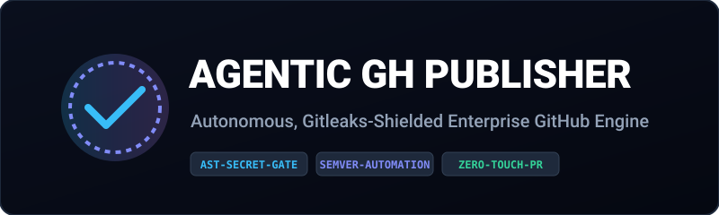

<p align="center">
  
</p>

# Agentic GH Publisher

[](https://github.com/Amz34/agentic-gh-publisher/actions)
[](https://opensource.org/licenses/MIT)
[](https://github.com/gitleaks/gitleaks)
[](https://www.python.org/)

> **Autonomous, zero-leak enterprise GitHub repo scaffolder, CI/CD injector, and publisher engineered for AI agent worktrees.**

---

## The Tech Problem It Solves

When autonomous AI agent swarms produce codebases across local VMs, publishing them directly creates critical liabilities:
1. **Accidental Credential Exposure**: Agents dumping API keys or OAuth secrets into Git commit history.
2. **Unformatted Commits & Broken Presentation**: Missing standard license files, unverified commit signatures, and broken badges.
3. **Manual Overhead**: Developers spending hours hand-scaffolding CI/CD workflows and topics.

**`agentic-gh-publisher`** turns any raw agent folder into an enterprise-ready repository with an unbreakable Gitleaks gate, dynamic SVG badges, Semantic Release workflows, and GitHub API synchronization.

---

## Architectural Workflow
```
[Agent Workspace] ──> [Gitleaks AST Scan] ──> [CI/CD Injection] ──> [Conventional Commits] ──> [gh API Push]
```

---

## License
[MIT License](LICENSE) © 2026 Aamir Zahran
